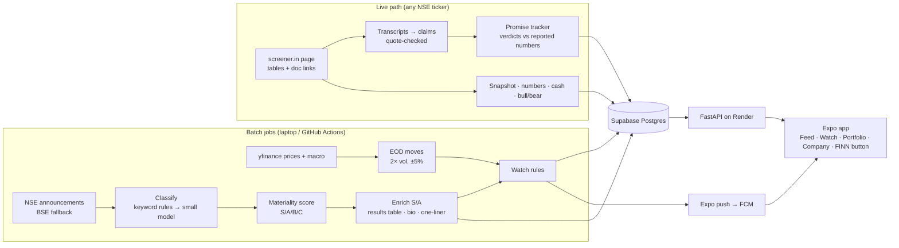

# FINN: a phone-first investment agent

FINN shows an investor only what matters to **their** portfolio, then lets them dig into any of it in one tap. Push and pull are one loop. Every filing is ranked S/A/B/C by how material it is to you, every important item opens a cited research view, and every research view ends in something you can watch.

**Headline feature:** the promise tracker compares what management guided in the last 4–6 earnings calls with what they actually delivered.

Setup and external accounts are in **[SETUP.md](SETUP.md)**.

## Layout

```
backend/                FastAPI + batch jobs (Python)
  finn/classify.py      NSE subject → category (keyword rules; small model only for leftovers)
  finn/score.py         materiality = category weight × relevance × surprise × boost → S/A/B/C
  finn/enrich.py        results table (PDF → Gemini, arithmetic-checked; screener fallback), CFO/CEO bio, one-liners
  finn/pipeline.py      ingest → classify → score → enrich S/A → rescore; merges same-day price moves
  finn/rules.py         watch-rules engine + natural-language → rule (regex first, model second)
  finn/research/        screener.in parser, promise tracker, company cards, impact tree
  finn/assistant.py     FINN button: ask / command / go
  finn/llm.py           routing (Groq/Gemini small → mid → strong), cache by content hash, token log
  jobs/run.py           poll · eod · brief · research · load-snapshot
app/                    Expo (SDK 58) + Expo Router: Feed · Watch · Portfolio tabs, Company, Filing, Impact
.github/workflows/      scheduled batch jobs + keep-alive
render.yaml             backend deploy
```

## Architecture



## Run it on any NSE ticker

- **In the app:** search any ticker on the Feed tab. The Company screen builds it live (≈1 min, progress shown), then caches it.
- **From the API:** `GET /company/<TICKER>` starts the build and returns progress; call again until `status: ready`.
- **From the CLI:** `cd backend && python -m jobs.run research <TICKER> [<TICKER> …]`

## Model routing and cost

| Task | Model | Why |
|---|---|---|
| Filing category | keyword rules → Groq `gpt-oss-20b` for leftovers | subject line usually suffices |
| One-liners, bios | Gemini Flash-Lite | bulk, short output |
| Results table from PDF, transcript claims, exposures | Gemini Flash (Flash-Lite fallback) | reads PDFs; long context |
| Direction-claim verdicts, bull/bear | Gemini Pro | real reasoning; a few calls per company |
| Assistant intent / rule parsing | regex first → Groq `gpt-oss-20b` | must feel instant |
| Speech to text | Groq Whisper large-v3-turbo | free, fast |

Runtime cost: **₹0**. All calls fit the Gemini and Groq free tiers. Every call is cached by
sha256(task + prompt version + model + document), so re-runs cost nothing. Live per-feature usage
(calls, tokens, cache hits) is at `GET /stats/cost`.

**Measured usage for this demo** (all of it on free tiers, so ₹0). Totals across building the 30-day demo feed for 15 holdings + 31 peers,
2 full research views (Infosys, HDFC Bank) and the impact-tree exposures for the portfolio:

| Feature | Model | Calls | Input tokens | Output tokens |
|---|---|---|---|---|
| Filing classification (leftovers only; ~95% handled by rules) | Groq gpt-oss-20b | 117 (+81 cache hits) | 27k | 27k |
| Results tables from PDFs | Gemini Flash / Flash-Lite | 35 | 176k | 6.9k |
| Management-change bios | Gemini Flash-Lite | 7 | 22k | 0.6k |
| One-line summaries (A items, batched 8 per call) | Gemini Flash-Lite | 1 | 0.9k | 0.8k |
| Promise-tracker claims (4–6 transcripts per company) | Gemini Flash | 18 | 81k | 3.0k |
| Snapshot + bull/bear | Gemini Flash / Flash-Lite | 8 | 44k | 1.9k |
| Impact-tree exposures (annual reports, ≤25 pages each) | Gemini Flash-Lite / Flash | 31 | 225k | 2.5k |

Roughly **40k input tokens per company research view** and **~5k per enriched filing**. Rules handle most filings
for free, only S/A items reach a model, and cache hits cost nothing. Live numbers: `GET /stats/cost`.

## Impact tree

How one outside event reaches your holdings, using **only exposures each company disclosed in its own annual report**.
The research job reads the MD&A and risk sections and records exposures from a fixed vocabulary (crude oil, USD/INR,
interest rates, steel, coal and power, monsoon and rural demand, US tech spending, government capex, gold). Each one gets
a direction (helps/hurts), a strength, and the exact quote and page, which is string-matched against the report.
A large daily move in crude (`CL=F`), USD/INR (`USDINR=X`) or gold (`GC=F`), or a macro watch rule, opens
event → exposure → holdings with a +/− on each edge. Tap a holding for the quote. One level deep, no impact-size
estimates: edges are disclosed exposures, not forecasts. `GET /impact/CL=F`

## API

`GET /feed?window=24h|3d|7d` · `GET /filing/{id}` · `GET /alerts` · `GET/POST/PATCH/DELETE /rules` · `POST /rules/parse` ·
`GET /company/{ticker}` (builds on first call and returns progress) · `GET /impact/{series}` · `GET /search?q=` ·
`GET /portfolio` · `PUT /portfolio/prefs` · `POST /assistant` · `POST /assistant/voice` · `POST /push/register` · `GET /stats/cost`


## Grounding

The pull side reads only exchange filings, annual reports and transcripts (via screener.in links). Every claim carries a source and page. Each extracted quote is string-matched against its document, and claims whose quote can't be found are dropped. When the sources don't answer a question, FINN says "Not in the sources."
